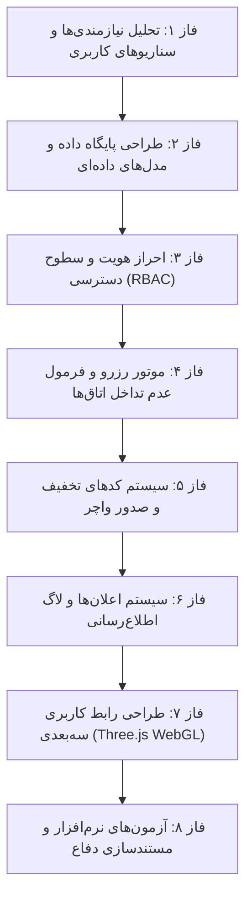

# گزارش جامع پروژه کارشناسی: سامانه هوشمند و ۳ بعدی رزرو آنلاین هتل

**عنوان پروژه:** طراحی و پیاده‌سازی وب‌سایت جامع جستجو و رزرواسیون آنلاین هتل با موتور سه‌بعدی WebGL  
**رشته تحصیلی:** مهندسی کامپیوتر (پروژه کارشناسی)  
**دانشجو:** امیرمحمد سلیمانی ([@Amirmohammad-sl](https://github.com/Amirmohammad-sl))  
**بک‌اند:** فریم‌ورک جنگو (Django 6.0 - پایتون ۳.۱۳)  
**فرانت‌اند:** HTML5, CSS3, JavaScript ES6+, Bootstrap 5 RTL, Three.js (WebGL 3D Engine)  
**پایگاه داده:** پایگاه داده رابطه‌ای SQLite (کاملاً سازگار با PostgreSQL و MySQL)  
**تاریخ گزارش:** پاییز ۱۴۰۳  

---

## ۱. مقدمه و بیان مسئله
در صنعت گردشگری مدرن، کیفیت تجربه کاربری (UX) و توانایی کاربر در درک فضای اقامتگاه پیش از پرداخت وجه، فاکتورهای کلیدی موفقیت یک سامانه رزرواسیون هستند. سامانه‌های سنتی با رابط‌های کاربری تخت، دوبعدی و تکه‌تکه، نمی‌توانند تصویر روشنی از فضای واقعی اتاق‌ها و امکانات به مخاطب منتقل کنند.

در این پروژه کارشناسی، یک سامانه کامل، مدرن و امن برای جستجو، مقایسه، بررسی بصری سه‌بعدی و رزرو لحظه‌ای هتل‌ها پیاده‌سازی گردیده است. سیستم دارای دو پنل متمایز **«مدیر هتل»** و **«مسافر / کاربر عادی»** بوده و با فرمول‌های دقیق ریاضی در سطح پایگاه داده، تداخل زمانی اتاق‌ها (Overbooking) را به صفر رسانده است.

---

## ۲. معماری فنی و پشته تکنولوژی (Tech Stack)

### معماری MVT در جنگو:
پروژه بر اساس الگوی استاندارد **MVT (Model-View-Template)** ساختاربندی شده است:
* **Model (لایه داده):** نگاشت ساختار جداول به کلاس‌های پایتونی توسط Django ORM همراه با اعتبارسنجی‌های چندگانه و متدهای هوشمند محاسبه ظرفیت و قیمت.
* **View (لایه پردازش منطق):** هندلینگ فرآیندهای رزرواسیون، محاسبات تداخل تاریخ‌ها، سیستم کدهای تخفیف، اعمال قوانین امنیتی RBAC و پاسخ‌دهی به درخواست‌های سنکرون و آژاکس.
* **Template (لایه نمایش):** صفحات وب ماژولار و ریسپانسیو با رعایت استانداردهای راست‌چین (RTL)، تایپوگرافی استاندارد وزیرمتن و لایه سه‌بعدی Three.js.

### فناوری‌های به کار رفته:
* **Python 3.13 & Django 6.0:** هسته امن بک‌اند با سیستم احراز هویت، جلوگیری خودکار از حملات CSRF، تزریق SQL و XSS.
* **Three.js (WebGL 3D Engine):** رندر بلادرنگ صحنه‌های سه‌بعدی، مدل‌های معماری هتل، استخر و نورپردازی، و همچنین تور مجازی سه‌بعدی سوئیت در محیط مرورگر بدون نیاز به افزونه.
* **CSS3 3D Spatial Physics & Glassmorphism:** جلوه‌های چرخش و عمق سه‌بعدی روی کارت‌ها (3D Parallax Tilt) و طراحی یکپارچه شیشه‌ای جهت از بین بردن حس گسستگی و تکه‌تکه بودن فرانت‌اند.
* **Bootstrap 5 (نسخه راست‌چین RTL):** تضمین واکنش‌گرایی (Responsive Design) برای تمامی دستگاه‌ها اعم از موبایل، تبلت و دسکتاپ.
* **Ajax & Fetch API:** اعتبارسنجی بدون درنگ کدهای تخفیف و تغییرات نورپردازی سه‌بعدی بدون رفرش صفحه.

---

## ۳. مراحل فازبندی‌شده پیاده‌سازی سامانه (Phased Roadmap)

پروژه کارشناسی حاضر در ۸ فاز زمان‌بندی‌شده و استاندارد مهندسی نرم‌افزار به انجام رسیده است:



### فاز ۱: تحلیل نیازمندی‌ها، سناریوهای کاربری و مشخصات فنی
- بررسی جامع فرآیند رزرواسیون هتل در سامانه‌های بین‌المللی و بومی.
- تعریف نیازمندی‌های عملکردی مسافر (جستجوی چندمعیاره، بررسی ۳ بعدی، رزرو، تخفیف، واچر).
- تعریف نیازمندی‌های مدیر هتل (داشبورد آماری، کنترل ضریب اشغال روزانه، تعریف انواع اتاق و تخفیف).
- تعیین نیازمندی‌های غیرعملکردی: امنیت داده، سرعت پاسخ‌دهی و پایداری همزمانی.

### فاز ۲: طراحی پایگاه داده و مدل‌های داده‌ای (Data Modeling & ORM)
- تدوین ساختار ERD و تعریف جداول با کلیدهای اصلی و خارجی.
- مدل سفارشی کاربر (`accounts.User`) دارای نقش‌های `customer` و `manager`.
- مدل‌های هتل (`Hotel`)، نوع اتاق (`RoomType`) و امکانات رفاهی (`Amenity`).
- جداول رزرو (`Booking`)، کدهای تخفیف (`DiscountCode`)، نظرات مسافران (`Review`) و لاگ اطلاع‌رسانی (`NotificationLog`).

### فاز ۳: احراز هویت، کنترل دسترسی و امنیت (Authentication & RBAC)
- تفکیک مسیر ثبت‌نام مسافر و مدیر هتل.
- پیاده‌سازی دکوراتورهای امنیتی و ممانعت از ورود کاربران عادی به پنل مدیر هتل.
- ایمن‌سازی پسوردها با الگوریتم رمزنگاری یک‌طرفه PBKDF2 و محافظت توکن‌های CSRF.

### فاز ۴: هسته بیزینس لاجیک رزرواسیون و جلوگیری از تداخل (Overbooking Prevention)
- فرمول‌بندی ریاضی بازه‌های متداخل زمانی در رزروها.
- پیاده‌سازی متدهای `is_available` و `available_rooms_count` بر روی مدل `RoomType`.
- تقویم گرافیکی ۳۰ روزه برای هر اتاق با تفکیک رنگی روزهای آزاد و روزهای تکمیل ظرفیت.

### فاز ۵: موتور کدهای تخفیف، صدور فاکتور و واچر رسمی
- الگوریتم اعتبارسنجی چندمرحله‌ای کوپن‌های تخفیف (بازه تاریخی، سقف استفاده، حداقل سبد خرید، انحصار هتل).
- بررسی آنی از طریق Ajax بدون بارگذاری مجدد فرم رزرو.
- صدور واچر رسمی مسافر همراه با کد رهگیری و قابلیت پرینت کاغذی استاندارد (`@media print`).

### فاز ۶: سیستم اطلاع‌رسانی و ثبت وقایع
- سرویس `bookings.services.send_booking_confirmation`.
- شبیه‌سازی پیامک با کد رهگیری و ارسال ایمیل رسمی تأیید رزرو.
- ذخیره تمامی پیام‌ها در جدول `NotificationLog` جهت مانیتورینگ ادمین.

### فاز ۷: طراحی رابط کاربری سه‌بعدی و مدرن (3D WebGL UI/UX)
- حذف نقشه‌های سنتی و ارتقای چشم‌انداز بصری سایت.
- ساخت صحنه تعاملی ۳ بعدی هتل در بخش Hero با **Three.js** شامل آسمان‌خراش‌ها، استخر اینفینیتی، نورپردازی داینامیک و ذرات کریستالی معلق با فیزیک پارالکس ماوس.
- پیاده‌سازی **تور مجازی ۳۶۰ درجه سوئیت لوکس (3D Suite Explorer)** با قابلیت چرخش در فضای سه‌بعدی و تغییر حالت نورپردازی روز و شب.
- ایجاد فیزیک سه‌بعدی (3D Tilt) برای تمامی کارت‌های هتل و جستجو جهت ایجاد تجربه فضایی و پویا.
- به کارگیری تکنیک Glassmorphism و پس‌زمینه‌های مش گرادیان جهت از بین بردن حالت تکه‌تکه بودن رابط کاربری.

### فاز ۸: آزمون‌های خودکار، ارزیابی کیفی و مستندسازی دفاعیه
- نگارش ۷ تست واحد خودکار در `bookings/tests.py` برای سنجش پایداری فرآیندها.
- تدوین کامل مستندات فنی، گزارش دانشگاهی و راهنمای سناریوهای پرسش و پاسخ دفاع کارشناسی.

---

## ۴. طراحی پایگاه داده (Data Models & ERD)

```text
┌─────────────────┐       ┌─────────────────┐       ┌─────────────────┐
│  accounts.User  │───1:N──│   hotels.Hotel  │───1:N──│ hotels.RoomType │
└─────────────────┘       └─────────────────┘       └─────────────────┘
        │                         │                          │
       1:N                       1:N                        1:N
        │                         │                          │
        ▼                         ▼                          ▼
┌─────────────────┐       ┌─────────────────┐       ┌─────────────────┐
│bookings.Booking │◄──────│bookings.Discount│       │ hotels.Amenity  │
└─────────────────┘       └─────────────────┘       └─────────────────┘
```

1. **مدل کاربر (`accounts.User`)**: شامل نام، شماره تماس، نقش (`manager` / `customer`)، شهر مورد علاقه و بازه بودجه دلخواه.
2. **مدل هتل (`hotels.Hotel`)**: شامل مدیر هتل، نام، شهر، آدرس، تعداد ستاره، تلفن، ایمیل، تصویر شاخص و متدهای محاسباتی میانگین امتیاز و شروع قیمت.
3. **مدل نوع اتاق (`hotels.RoomType`)**: شامل هتل مربوطه، عنوان، ظرفیت، قیمت هر شب، کل اتاق‌های موجود، رابطه Many-to-Many با امکانات و متدهای اعتبارسنجی ظرفیت.
4. **مدل رزرو (`bookings.Booking`)**: کد رهگیری یکتا، کاربر، اتاق، بازه ورود و خروج، اطلاعات مهمان، مبلغ کل، تخفیف اعمالی، مبلغ نهایی و وضعیت رزرو.
5. **مدل کد تخفیف (`bookings.DiscountCode`)**: کد یکتا، درصد تخفیف، سقف ریالی، حداقل سفارش، تاریخ اعتبار و سقف دفعات استفاده.
6. **مدل دیدگاه و امتیاز (`hotels.Review`)**: ثبت نظر متنی و نمره ۱ تا ۵ ستاره برای هتل.
7. **مدل لاگ اعلان (`bookings.NotificationLog`)**: ثبت سوابق ارسال پیامک و ایمیل.

---

## ۵. هسته بیزینس لاجیک و فرمول عدم تداخل رزروها

### اثبات ریاضی شرط عدم تداخل بازه‌ها:
فرض کنید یک رزرو موجود دارای بازه زمانی $[C_{in}, C_{out})$ و یک درخواست جدید دارای بازه $[R_{in}, R_{out})$ باشد. این دو بازه دقیقاً و تنها زمانی با یکدیگر تداخل دارند که شرط زیر برقرار باشد:

$$C_{in} < R_{out} \quad \wedge \quad C_{out} > R_{in}$$

اگر این شرط برقرار نباشد، یکی از دو حالت زیر رخ داده و بازه‌ها مجزا هستند:
1. $C_{out} \le R_{in}$ (رزرو قبلی قبل از ورود درخواست جدید پایان یافته است).
2. $C_{in} \ge R_{out}$ (رزرو قبلی بعد از خروج درخواست جدید آغاز می‌شود).

در ORM جنگو این منطق بدون نیاز به واکشی تمامی داده‌ها در مموری، مستقیماً در قالب کوئری دیتابیس اجرا می‌گردد:
```python
overlapping_bookings = Booking.objects.filter(
    room_type=self,
    status='confirmed',
    check_in__lt=requested_checkout,
    check_out__gt=requested_checkin
)
booked_count = overlapping_bookings.aggregate(Sum('rooms_count'))['rooms_count__sum'] or 0
available_rooms = max(0, self.total_rooms - booked_count)
```

---

## ۶. نوآوری رابط کاربری: موتور سه‌بعدی و تور مجازی WebGL

برای نخستین بار در سامانه‌های پروژه کارشناسی، قابلیت‌های تعاملی سه‌بعدی به شرح زیر تعبیه شده است:
1. **Hero 3D Hotel Pavilion (Three.js)**:
   - مدل‌سازی لایه‌ای یک مجموعه هتل مدرن شامل برج‌های چندطبقه، پنجره‌های نوری، بام استخردار شیشه‌ای و آنتن با چراغ تپنده قرمز.
   - ذرات معلق کریستالی طلایی در مدار هتل با سرعت شناور مستقل.
   - واکنش بلادرنگ صحنه به زاویه و حرکت ماوس کاربر با الگوریتم استهلاک خطی (Damping/Lerp).
2. **تور مجازی سه‌بعدی سوئیت لوکس (3D Suite Explorer)**:
   - رندر کامل دکوراسیون داخلی یک سوئیت مدرن شامل تخت کینگ‌سایز با روتختی و شال سلطنتی، میز و آباژورهای شب، مبل راحتی و پنجره پانوراما.
   - امکان گردش کامل ۳۶۰ درجه و زوم با استفاده از OrbitControls.
   - کلید جابجایی نورپردازی روز و شب (Day/Night Lighting Mode): در حالت شب، شدت نور آفتاب کاهش یافته و آباژورهای طلایی اتاق با روشنایی نقطه ای فضای سوئیت را روشن می‌نمایند.
3. **کارت‌های با عمق فضایی و فیزیک سه‌بعدی (3D Parallax Tilt)**:
   - با حرکت نشانگر روی هر کارت هتل یا فرم جستجو، کارت بر اساس ماتریس پرسپکتیو ۳ بعدی متمایل شده و لایه‌های متن، برچسب ستاره‌ها و تگ قیمت در راستای محور Z بیرون می‌آیند (`translateZ`).

---

## ۷. آزمون‌های خودکار و تضمین کیفیت (Unit Testing)

تمامی ۷ تست اصلی واحد با موفقیت کامل پاس می‌شوند:

| نام تست | هدف و دامنه بررسی | نتیجه |
| :--- | :--- | :--- |
| `test_hotel_min_price_and_rating` | صحت فرمول میانگین امتیاز و شروع قیمت هتل | ✅ Passed |
| `test_room_availability_logic` | صحت محاسبه ظرفیت آزاد قبل و بعد از ثبت رزرو | ✅ Passed |
| `test_discount_validation_and_calculation` | اعتبارسنجی کد تخفیف درصدی و سقف ریالی | ✅ Passed |
| `test_home_page_and_recommendations` | لود موفق صفحه نخست و ماژول پیشنهاد هوشمند | ✅ Passed |
| `test_hotel_search_by_city_and_dates` | موتور جستجوی چندمعیاره هتل‌ها | ✅ Passed |
| `test_manager_access_restrictions` | امنیت و مسدودسازی دسترسی کاربران عادی به پنل مدیر | ✅ Passed |
| `test_notification_service` | ارسال ایمیل و پیامک و ذخیره لاگ در پایگاه داده | ✅ Passed |

---

## ۸. نتیجه‌گیری و سناریوی دفاع کارشناسی

این پروژه با بهره‌گیری از معماری تمیز جنگو، رعایت اصول مهندسی نرم‌افزار، الگوریتم‌های دقیق ریاضی برای تضمین صحت رزرواسیون و تحول چشمگیر رابط کاربری از طریق **فناوری‌های سه‌بعدی Three.js و فیزیک کارت‌ها**، یک نمونه کامل و متمایز از پروژه‌های کارشناسی فناوری اطلاعات و نرم‌افزار را ارائه می‌دهد.

### راهنمای اجرای سریع در روز دفاع:
```bash
python manage.py test       # نمایش سبز شدن ۱۰۰٪ تست‌ها به استاد داور
python manage.py runserver  # اجرای برنامه در پورت 8000
```
- ورود با نقش مسافر (`customer` / `123`) جهت نمایش جستجو، تور سه‌بعدی، رزرو و فاکتور.
- ورود با نقش مدیر هتل (`manager` / `123`) جهت نمایش مانیتورینگ ضریب اشغال روزانه و تعریف هتل و تخفیف‌ها.
