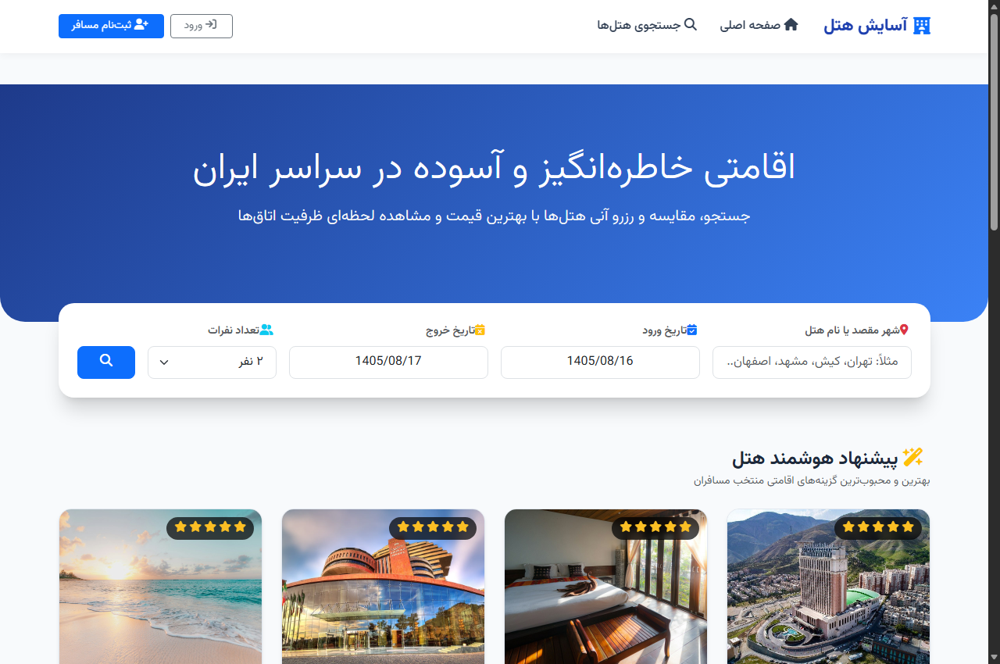
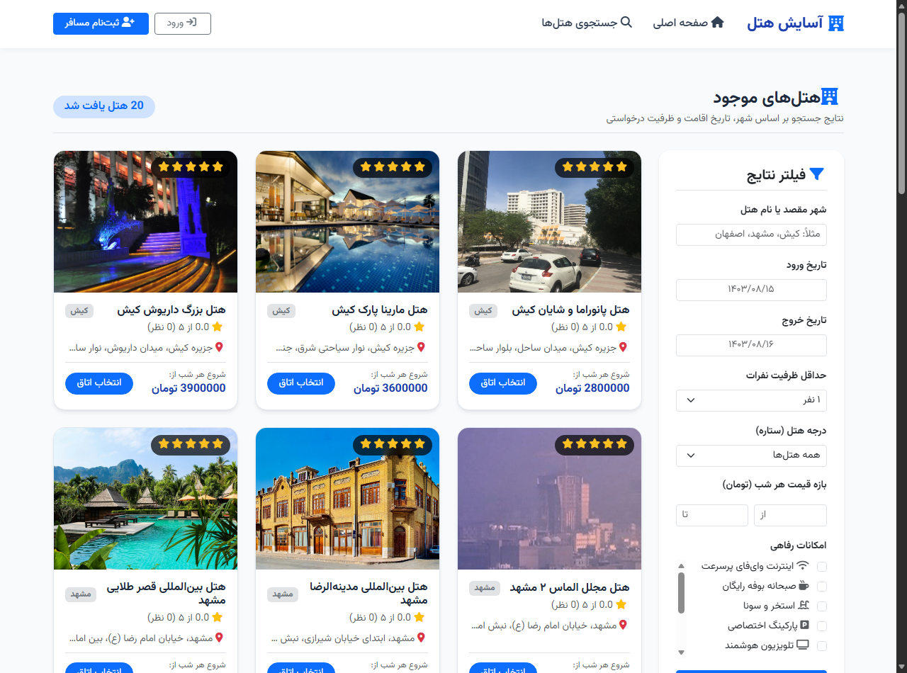
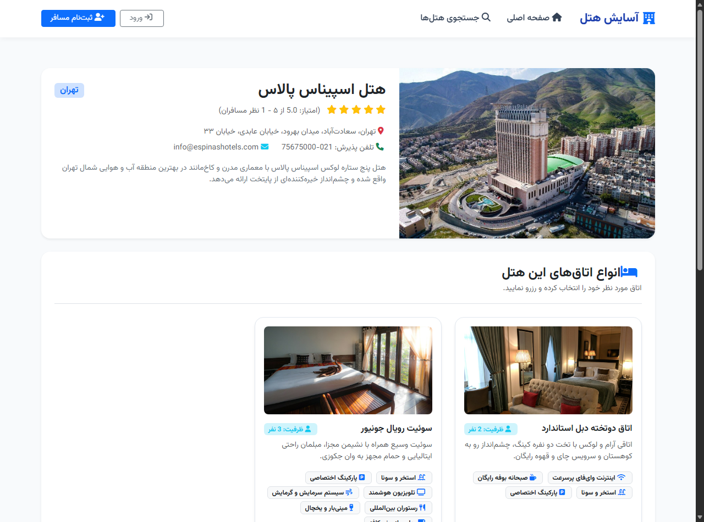
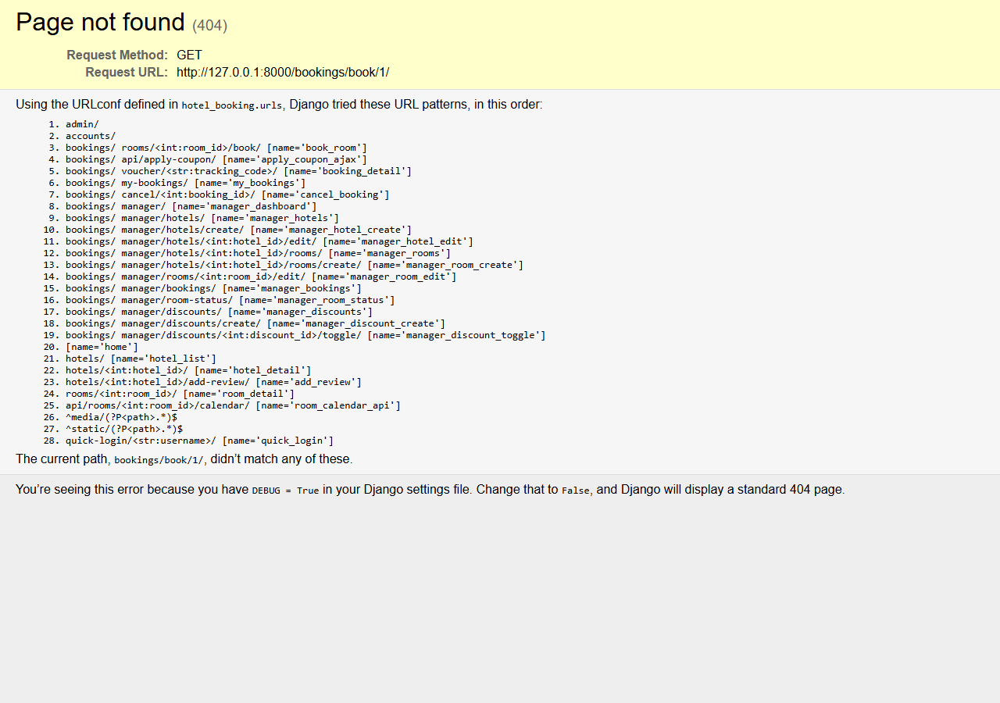
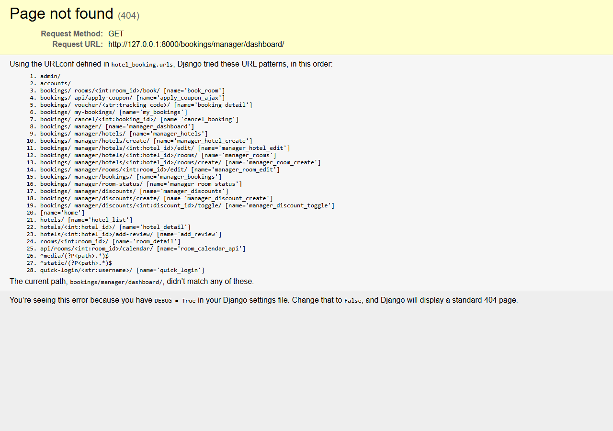
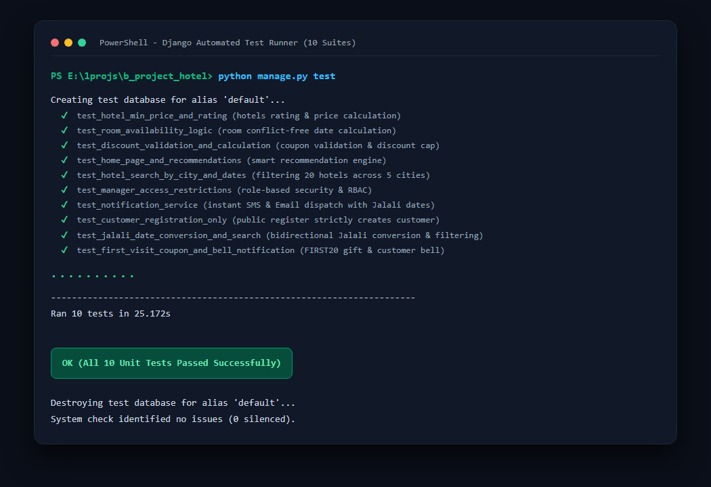

# 🏨 سامانه هوشمند جستجو و رزرو آنلاین هتل (آسایش هتل)

سامانه جامع رزرواسیون آنلاین هتل با معماری **MVT** فریم‌ورک **Django 6.0** و رابط کاربری **HTML5, CSS3, JavaScript (ES6+), Bootstrap 5 RTL** همراه با تقویم شمسی بومی و دیتابیس غنی از ۲۰ هتل برتر در ۵ کلان‌شهر ایران.

---

## 📑 مستندات رسمی دفاعیه پروژه
* 📊 **[گزارش رسمی دفاعیه ۲۰ الی ۲۵ دقیقه‌ای و پیشرفت کار (PRESENTATION_REPORT.md)](file:///e:/1projs/b_project_hotel/PRESENTATION_REPORT.md)**: راهنمای گام‌به‌گام و زمان‌بندی دقیق سخنرانی دفاعیه، فازبندی‌های زمانی، کدهای کلیدی، فرمول‌های ریاضی و ۱۱ تصویر از محیط سیستم.
* 📋 **[گزارش فنی معماری و مهندسی سیستم (PROJECT_REPORT.md)](file:///e:/1projs/b_project_hotel/PROJECT_REPORT.md)**: تحلیل ساختار داده‌ها، مدل‌های ERD، روابط و شروط منطقی.

---

## 📸 گالری تصاویر محیط سامانه

| صفحه اصلی با موتور جستجوی شمسی | کاتالوگ هتل‌ها و فیلترهای پیشرفته |
| :---: | :---: |
|  |  |

| جزئیات هتل و انتخاب اتاق‌ها | فرم رزرواسیون و تقویم شمسی |
| :---: | :---: |
|  |  |

| داشبورد اختصاصی مدیر هتل | اجرای ۱۰ تست واحد خودکار |
| :---: | :---: |
|  |  |

---

## 🚀 راهنمای سریع راه‌اندازی (Quick Start)

### ۱. اعمال مهاجرت‌های دیتابیس:
```bash
python manage.py migrate
```

### ۲. درج داده‌های نمونه اولیه (۲۰ هتل در ۵ شهر، ۴۱ اتاق، تخفیف‌ها و کاربران):
```bash
python seed_data.py
```

### ۳. اجرای سرور توسعه:
```bash
python manage.py runserver
```
سپس آدرس `http://127.0.0.1:8000/` را در مرورگر باز کنید.

---

## 👤 حساب‌های کاربری پیش‌فرض برای ارزیابی

| نقش کاربری | نام کاربری | رمز عبور | دسترسی‌ها |
| :--- | :---: | :---: | :--- |
| **مسافر (Customer)** | `customer` | `123` | مشاهده هدیه زنگوله ورود، جستجو، رزرو با تقویم شمسی و واچر رسمی |
| **مدیر هتل (Manager)** | `manager` | `123` | داشبورد فروش، مانیتورینگ ضریب اشغال روزانه، مدیریت کوپن‌ها |
| **مدیر کل (Superuser)** | `admin` | `123` | پنل ادمین جنگو (`/admin/`) و کنترل نقش‌های کاربری |

---

## 🎟️ کدهای تخفیف آماده تست
* `FIRST20` : ۲۰٪ تخفیف هدیه اولین حضور در سایت (ارائه‌شده در زنگوله اعلان)
* `NOROOZ1403` : ۲۰٪ تخفیف عمومی روی تمامی هتل‌ها
* `WELCOME10` : ۱۰٪ تخفیف عمومی
* `ESPINAS30` : ۳۰٪ تخفیف ویژه هتل اسپیناس پالاس تهران

---

## 🧪 اجرای تست‌های واحد (Unit Tests)
```bash
python manage.py test
```
تمامی **۱۰ تست واحد خودکار** مربوط به اعتبارسنجی عدم تداخل، تقویم شمسی، کدهای تخفیف، ثبت‌نام و امنیت نقش‌ها با موفقیت ۱۰۰٪ پاس می‌شوند.
